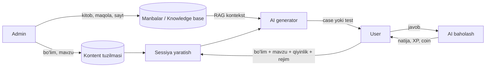

# TZ: AI orqali real-time Case va Test generatsiya

**Holat:** Qoralama (ko'rib chiqish uchun) · **Sana:** 2026-10-24

---

## 1. Maqsad

Hozirgi modelda case'lar admin panelda qo'lda yaratiladi (bemor shikoyati, to'g'ri javob,
qiyinlik, rasm). Yangi modelda:

- Admin faqat **bo'lim (category)** va **mavzu (topic)** yaratadi, hamda AI uchun **manbalar** (kitob, maqola, veb-sayt) yuklaydi.
- Foydalanuvchi (user-app) o'zi **bo'lim, mavzu, qiyinlik, rejim** tanlaydi va AI **real-time** case yoki test generatsiya qilib beradi.
- Case'lar oldindan tayyorlanmaydi — har bir sessiyada AI yangisini yaratadi.

## 2. Hozirgi holat (AS-IS)

| Element | Holat |
|---|---|
| Bo'limlar `/web/category`, mavzular `/web/topic` | Mavjud (CRUD) |
| Case `/web/case` | Admin qo'lda yaratadi / `import` / `ai-generate` / `ai-generate-batch` (draft → publish) |
| Manbalar `/web/case-source` | Mavjud: faqat `name` + `content` (havola yoki matn) |
| Test | **Yo'q** |
| User tomonida real-time generatsiya | **Yo'q** |

## 3. Yangi holat (TO-BE)

### 3.1 Rollar va oqim



### 3.2 Foydalanuvchi oqimi

1. User **bo'lim** tanlaydi → **mavzu** tanlaydi (bir yoki bir nechta, ixtiyoriy "Aralash").
2. **Qiyinlik**: `easy | medium | hard`.
3. **Rejim**:
   - **Case (erkin javob)** — AI bemor shikoyatini beradi, user javob/tashxisni matn bilan yozadi, AI baholaydi.
   - **Test** — AI ko'p variantli savollar beradi, user variant tanlaydi.
4. **Boshlash** → AI birinchi case/savolni generatsiya qiladi.
5. User javob beradi → natija/izoh ko'rsatiladi → "Keyingisi" → AI yangisini yaratadi (takrorlanmasligi kerak).
6. Sessiya tugaydi (user to'xtatadi yoki limit tugaydi) → yakuniy natija.

## 4. Funksional talablar

### 4.1 Admin panel

**4.1.1 Bo'limlar va mavzular** (mavjud CRUD saqlanadi, soddalashtiriladi)
- Bo'lim: nom (uz/ru/en), tavsif, tartib, faol/nofaol.
- Mavzu: bo'limga bog'langan, nom, tavsif, faol/nofaol.
- Mavzuga qo'shimcha maydon (AI uchun): `ai_hint` — AI'ga yo'nalish (masalan, "faqat pediatrik holatlar").

**4.1.2 Manbalar (Source) — kengaytiriladi**
Hozir faqat `name` + `content`. Yangi tur'lar:

| Tur | Kiritish | Qayta ishlash |
|---|---|---|
| `book` | PDF / EPUB / DOCX fayl yuklash | Matn ajratish → chunklash → embedding |
| `article` | PDF fayl yoki matn | Xuddi shunday |
| `website` | URL | Sahifani yuklab, tozalab, chunklash (qayta indekslash imkoniyati) |
| `text` | Qo'lda matn (mavjud) | Chunklash |

Har manba uchun:
- `title`, `type`, `language`, `author` (ixtiyoriy), `url` yoki `file_url`
- **Bog'lash:** bir nechta bo'lim/mavzuga (`category_ids[]`, `topic_ids[]`); bo'sh bo'lsa — umumiy manba
- **Holat:** `uploaded → processing → ready | failed` (+ xato matni)
- Amallar: yuklash, tahrirlash, qayta indekslash, o'chirish, faol/nofaol

**4.1.3 Eski case bo'limi**
- Qo'lda case yaratish, `import`, `ai-generate(-batch)` — **faqat admin/arxiv** sifatida qoladi yoki yashiriladi (qarang: §10 savol 1).

**4.1.4 Monitoring (tavsiya)**
- Sessiyalar soni, bo'lim/mavzu bo'yicha statistika, AI xarajati (token), xato foizi.
- Foydalanuvchi shikoyati (noto'g'ri case/savol) ro'yxati.
- **Fleshkartalar statistikasi:** jami generatsiya qilingan kartalar soni, kunlik faol takrorlashlar, talabalar eng ko'p qiynalayotgan mavzular va o'zlashtirish (retention) ko'rsatkichlari.

### 4.2 User-app (frontend)

- **Boshlash ekrani:** bo'lim → mavzu → qiyinlik → rejim (Case/Test) → (Test uchun savollar soni).
- **Case rejimi:** shikoyat matni (+ AI rasm(ekg, yurak, rentgen, KT, MRT, uzi, sl, mskt va h.k uchun)), javob maydoni, "Yuborish", AI izohi (to'g'ri javob, tushuntirish) va **izoh ostida "Foydalanilgan manbalar" bloki** (§4.2.1).
- **Test rejimi:** savol + 4 variant (A–D), tanlash, darhol izoh, **izoh ostida "Foydalanilgan manbalar" bloki**, progress (n/N), yakuniy natija.

#### 4.2.1 "Foydalanilgan manbalar" bloki

User har bir case yoki test savoliga javob belgilagach, AI javobi/izohi chiqadi va **uning pastida** shu javobni yaratishda haqiqatan ishlatilgan manbalar ro'yxati ko'rsatiladi:

- Har manba: **tur belgisi** (📖 kitob, 📄 maqola, 🌐 veb-sayt), **nom**, muallif (bo'lsa), sahifa/bo'lim (bo'lsa).
- `website` turi — bosiladigan havola (yangi tabda ochiladi); `book`/`article` — nomi (fayl havolasi faqat admin ruxsat bergan bo'lsa).
- Bir manba takrorlanmaydi (dublikatlar birlashtiriladi); tartib — mosligi (relevance) bo'yicha.
- Faqat javob/izoh ochilgandan **keyin** ko'rsatiladi (javob berishdan oldin to'g'ri javob oshkor bo'lmasligi uchun).
- Agar manba ishlatilmagan bo'lsa (AI umumiy bilimi): "Manba topilmadi, javob umumiy tibbiy bilimga asoslangan" degan yozuv chiqadi.
- Ko'rinishi: yig'iladigan (collapsible) blok, sarlavha "Foydalanilgan manbalar (n)".
- Loading holati (generatsiya 5–30 s): skeleton / "AI case tayyorlamoqda…"; oldindan keyingisini generatsiya qilish (prefetch).
- Sessiya tarixi va natijalar.
- Xato holati: "Qayta urinish", "Savolni xabar qilish".

### 4.3 AI generatsiya

- **RAG:** tanlangan mavzu/bo'limga bog'liq manbalardan eng mos chunk'lar olinadi va promptga kontekst sifatida beriladi. Bog'liq manba bo'lmasa — umumiy manbalar; umuman bo'lmasa — AI umumiy bilimi (ogohlantirish bilan).
- **Case chiqishi (strukturali JSON):** `chief_complaint`, bemor ma'lumoti (yosh, jins, anamnez, ko'rik, analizlar), `expected_answer`, `explanation`, `difficulty`, `sources[]`.
- **Test chiqishi:** `question`, `options[4]`, `correct_index`, `explanation`, `difficulty`, `sources[]`.
- **`sources[]` formati:** `[{source_id, type (book|article|website|text), title, author, url, locator (sahifa/bo'lim)}]`. Ro'yxat AI'ning o'ziga "o'ylab topish" uchun berilmaydi — u **RAG'da haqiqatan promptga kiritilgan chunk'larning manbalaridan** backend tomonidan shakllantiriladi (to'qib chiqarilgan manbalarning oldini olish).
- **Takrorlanmaslik:** sessiyada oldin berilgan case/savol qisqa xulosasi promptga beriladi.
- **Qiyinlik ko'rsatkichi:** easy — klassik, aniq belgilar; medium — aralash belgilar; hard — atipik, differensial tashxis talab qiladi.
- **Til:** `Accept-Language` (uz/ru/en) bo'yicha.
- **Baholash (Case rejimi):** user javobi `expected_answer` bilan AI tomonidan solishtiriladi → `score (0–100)`, `verdict (correct|partial|wrong)`, `feedback`.
- **Xavfsizlik:** prompt injection'dan himoya (user matni alohida rol/delimiter ichida), tibbiy javobda "ta'lim maqsadida" disclaimer.
- **Kesh/prefetch:** keyingi case oldindan fonda generatsiya qilinadi (latency kamaytirish).

## 5. Ma'lumotlar modeli (taklif)

```text
categories(id, name_uz/ru/en, description, order, is_active)
topics(id, category_id, name_uz/ru/en, description, ai_hint, is_active)

sources(id, title, type[book|article|website|text], language, author,
        url, file_url, status[uploaded|processing|ready|failed], error,
        created_at, updated_at)
source_links(source_id, category_id NULL, topic_id NULL)
source_chunks(id, source_id, idx, content, embedding VECTOR, tokens)

practice_sessions(id, user_id, mode[case|test], category_id, topic_ids[],
                  difficulty, total_items, status[active|finished|abandoned],
                  score, started_at, finished_at)
practice_items(id, session_id, idx, kind[case|test], payload JSONB,   -- AI chiqishi
               source_chunk_ids[], user_answer JSONB, evaluation JSONB,
               is_correct, tokens_used, created_at)
```

> Eslatma: generatsiya qilingan case/test `practice_items.payload` da saqlanadi — alohida `cases` jadvaliga yozilmaydi (admin case'lari bilan aralashmaydi).

## 6. API (taklif)

### 6.1 Admin (`/web`, Bearer)

| Metod | URL | Izoh |
|---|---|---|
| CRUD | `/web/category`, `/web/topic` | Mavjud |
| POST | `/web/source` (multipart yoki JSON) | Manba yuklash (fayl / URL / matn) |
| GET | `/web/source` | Filtr: `type`, `status`, `category_id`, `topic_id`, `name` |
| GET | `/web/source/{id}` | Detal + holat |
| PUT | `/web/source/{id}/update` | Meta va bog'lanishlarni yangilash |
| POST | `/web/source/{id}/reindex` | Qayta indekslash |
| DELETE | `/web/source/{id}/delete` | Manba + chunk'larni o'chirish |
| GET | `/web/practice/stats` | Statistika |

> `/web/case-source` → `/web/source` ga migratsiya (eski endpoint bir muddat alias bo'lib turadi).

### 6.2 User-app

| Metod | URL | Izoh |
|---|---|---|
| GET | `/categories`, `/topics?category_id=` | Tanlash uchun ro'yxat |
| POST | `/practice/sessions` | Body: `mode`, `category_id`, `topic_ids[]`, `difficulty`, `count` (test) |
| POST | `/practice/sessions/{id}/next` | Keyingi case/savolni generatsiya qiladi |
| POST | `/practice/items/{id}/answer` | Javob yuborish → baholash natijasi |
| POST | `/practice/sessions/{id}/finish` | Yakunlash, natija |
| GET | `/practice/sessions`, `/practice/sessions/{id}` | Tarix |
| POST | `/practice/items/{id}/report` | Noto'g'ri kontent haqida xabar |

**Streaming (ixtiyoriy):** `next` endpointi SSE orqali javobni oqim bilan qaytarsa, UX yaxshiroq bo'ladi.

## 7. Qayta ishlash (ingestion) pipeline

1. Fayl yuklanadi (S3/storage) yoki URL saqlanadi → `status=processing`.
2. Matn ajratish (PDF/EPUB/DOCX parser; website — HTML → toza matn).
3. Chunklash (~500–800 token, overlap ~100).
4. Embedding hisoblash → vector DB (pgvector tavsiya).
5. `status=ready` yoki `failed` (+ sabab). **Fon (background job/queue)** da bajariladi.

Cheklovlar: fayl hajmi (masalan ≤ 50 MB), formatlar: PDF, EPUB, DOCX, TXT.

## 8. Nofunksional talablar

- **Latency:** birinchi case/savol ≤ ~15 s (prefetch bilan keyingilari deyarli darhol).
- **Xarajat nazorati:** foydalanuvchi uchun kunlik limit; mavjud **token/coin billing** (`CHANGES_FRONTEND_TOKEN_BILLING.md`) bilan integratsiya — har sessiya/savol narxi.
- **Ishonchlilik:** AI xato bersa retry (2 marta) → foydalanuvchiga tushunarli xabar; JSON schema validatsiya.
- **Sifat:** chiqish validatsiyasi (4 variant, bitta to'g'ri, bo'sh maydon yo'q).
- **Xavfsizlik:** admin endpointlar RBAC; yuklangan fayl skanerlash/MIME tekshiruvi.
- **Log/audit:** har generatsiya uchun prompt versiyasi, model, token, ishlatilgan chunk'lar.

## 9. Bosqichlar (rejalashtirish)

| Bosqich | Mazmun |
|---|---|
| **1. Manbalar** | Admin: kengaytirilgan source (fayl/URL), ingestion pipeline, embedding |
| **2. Case generator** | Sessiya, RAG, real-time case, baholash |
| **3. Test generator** | Test rejimi, natija |
| **4. User-app UI** | Tanlash oqimi, case/test ekranlari, tarix |
| **5. Billing & limit** | Coin/limit integratsiyasi, monitoring |
| **6. Migratsiya** | Eski case modulini arxivlash, hujjatlarni yangilash |

## 10. Ochiq savollar (aniqlashtirish kerak)

1. **Eski case'lar** (admin yaratgan) nima bo'ladi? O'chiriladimi, arxivlanadimi yoki user ularni ham ko'rishi mumkinmi?
2. **Test:** savollar soni qat'iy (10/20) yoki user tanlaydimi? Vaqt chegarasi (timer) kerakmi?
3. **Case rejimida** rasm (AI rasm yoki tibbiy tasvir) generatsiya qilinadimi?
4. **Case rejimida** bitta case — bir martalik javobmi yoki AI bilan **dialog** (qo'shimcha savollar berish, analiz so'rash)mi?
5. **Mavzu tanlash:** bitta mavzu yoki bir nechta/butun bo'lim aralash?
6. **XP/coin:** to'g'ri javob uchun XP beriladimi, har sessiya coin'ga tushadimi?
7. ~~Manba ko'rsatilsinmi?~~ **Hal qilindi:** ha, har bir javob ostida foydalanilgan manbalar ko'rsatiladi (§4.2.1). Savol: `book`/`article` fayliga user havola olishi (yuklab olish) mumkinmi, yoki faqat nomi ko'rsatiladimi (mualliflik huquqi)?
8. **Til:** manbalar asosan qaysi tilda (uz/ru/en)? Tarjima kerakmi?
9. **AI provayder:** hozirgi Gemini qoladimi? Embedding uchun qaysi model?
10. **Sifat nazorati:** AI yaratgan kontentni admin oldindan ko'rishi/moderatsiya qilishi kerakmi (yoki faqat user shikoyati bo'yicha)?

## 11. Qabul qilish mezonlari (Acceptance)

- [ ] Admin bo'lim va mavzu yaratadi; case yaratmasdan ishlatish mumkin.
- [ ] Admin PDF/EPUB/URL yuklaydi, status `ready` ga o'tadi, mavzuga bog'lanadi.
- [ ] User bo'lim/mavzu/qiyinlik/rejim tanlab sessiya boshlaydi.
- [ ] Case rejimi: AI case beradi, user javobini baholaydi, izoh ko'rsatadi.
- [ ] Test rejimi: AI savol + variantlar beradi, natija hisoblanadi.
- [ ] Ketma-ket case/savollar takrorlanmaydi.
- [ ] Generatsiya xarajati billing/limit bilan hisobga olinadi.
- [ ] Manba bog'langan bo'lsa, AI javobi shu manbaga tayanadi (log'da ko'rinadi).
- [ ] Har bir case/test javobidan keyin izoh ostida "Foydalanilgan manbalar" bloki chiqadi (kitob/maqola/veb-sayt belgisi, nom, sayt uchun havola).
- [ ] Ko'rsatilgan manbalar faqat RAG'da haqiqatan ishlatilgan chunk'lardan olinadi; manba bo'lmasa tegishli yozuv chiqadi.
